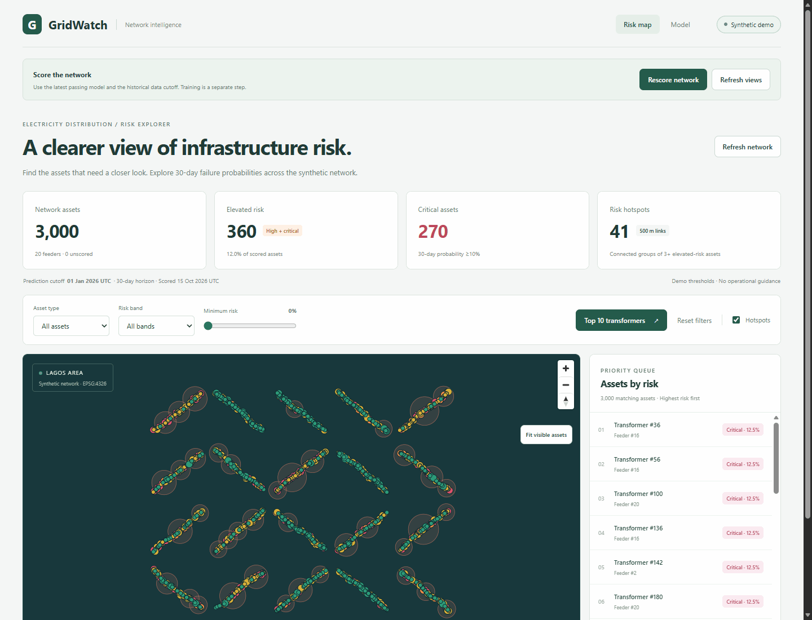
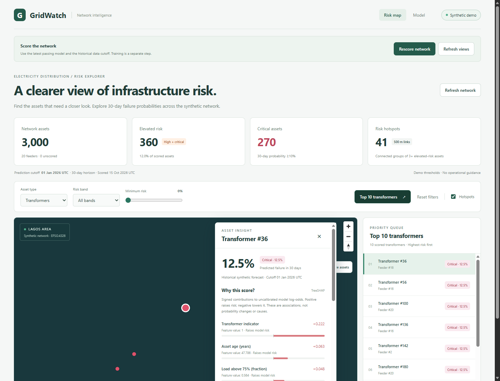
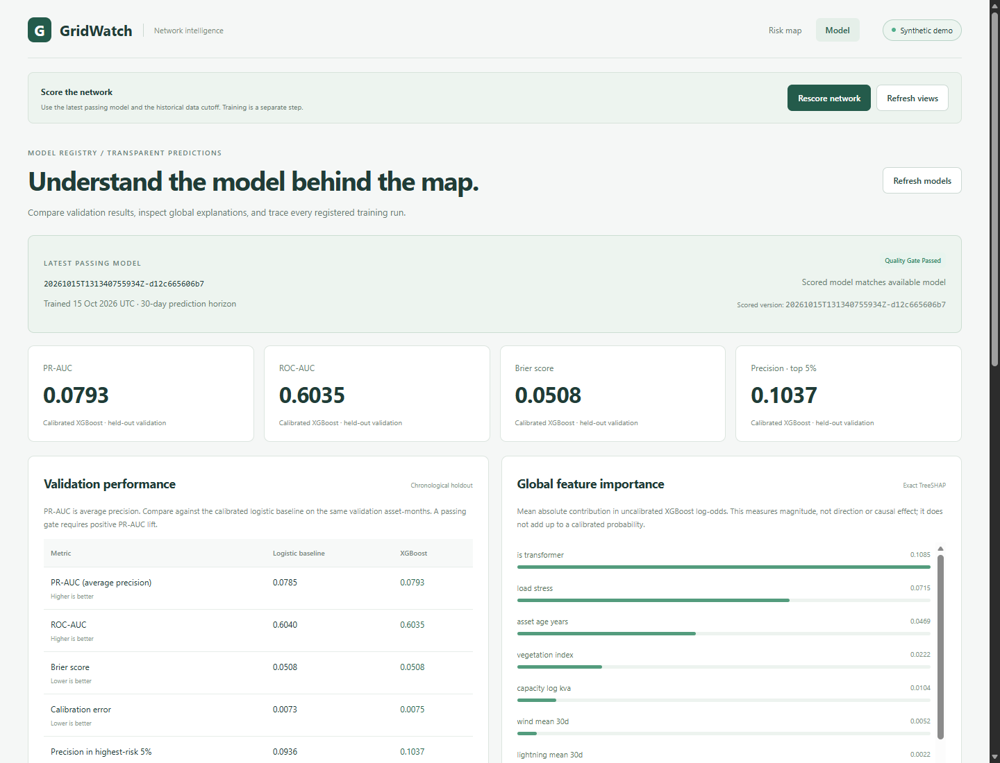
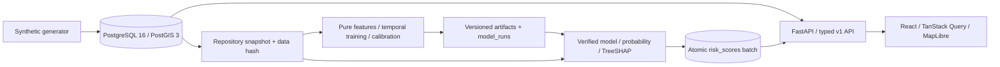

# GridWatch

[](https://github.com/oluwap3lumi/GridWatch/actions/workflows/ci.yml)

**Explore electricity-distribution failure risk, from synthetic data to an explained prediction on a map.**

GridWatch combines energy infrastructure, GIS, machine learning, and DevOps in a
full-stack portfolio project. Rank transformers by 30-day failure probability,
inspect signed SHAP factors and outage history, compare model versions, and
rescore the fleet without restarting the app.

All committed demo assets, weather, and outages are invented by [the generator](data/generator).
The Lagos-area coordinates represent a fictional network. Scores are historical
demo predictions, not live forecasts or maintenance guidance.


## See it work



1. Click **Top 10 transformers** to rank the complete fleet.
2. Select an asset in the list or map to see its strongest SHAP factors and outage history.
3. Open **Model** to inspect validation metrics, feature importance, and version history.
4. Train another version, click **Refresh models**, then **Rescore network** to update the map.





## Quickstart

Prerequisites: **Git, Docker with Compose v2, GNU Make, and Python 3** on your host.
Start Docker Desktop first on Windows/macOS. Docker installs the app's locked
Python and Node dependencies; host Node and uv are needed only for development.
Allow several GB of free disk space for container images and ML dependencies.

```sh
git clone https://github.com/oluwap3lumi/GridWatch.git
cd GridWatch
cp .env.example .env
# Replace POSTGRES_PASSWORD's placeholder in .env with a local password.
make up
make seed
make train
```

Open **http://localhost:5173**, then click **Rescore network**. When it reports
**Views refreshed**, the risk explorer is ready. The default corpus has 3,000
assets, 14,600 weather observations, and 4,608 outages. Predictions use a
2026-01-01 UTC cutoff and a 30-day horizon.

In PowerShell, `Copy-Item .env.example .env` also works. Make's Windows default
location is `C:\Program Files (x86)\GnuWin32\bin`; add it to PATH and open a new
terminal. On Linux/macOS the Makefile uses `python3`; on Windows it uses `python`.
Use `make PYTHON=python3 up` to override the task-runner interpreter if needed.

`make up` waits for the database, migrated API, and web to be healthy. No map token,
external tiles, paid account, or real utility data is required. A WebGL-capable
browser renders the map; the ranked list also supports asset selection.
Initial image downloads depend on your connection; see the measured rehearsal
and cache conditions in [M7 verification](docs/m7-verification.md).

## Architecture



Python 3.12, SQLAlchemy 2/GeoAlchemy2, Alembic, pandas, scikit-learn, CPU XGBoost,
SHAP, React, Vite, and TypeScript. Geometry is EPSG:4326; distance queries use
PostGIS geography. ML functions have no database calls. OpenAPI generates the
frontend API contracts. Read [architecture and transaction boundaries](docs/architecture.md).

## Model results and limits

Chronological validation: 5,979 asset-month rows, 323 positives, November–December
2025. Training, tuning, calibration, and validation have separate time windows;
labels that overlap a partition boundary are purged.

| Metric | Logistic regression | Calibrated XGBoost |
| --- | ---: | ---: |
| PR-AUC (average precision) | 0.078531 | 0.079324 |
| ROC-AUC | 0.603961 | 0.603519 |
| Precision at top 5% | 0.093645 | 0.103679 |

The PR-AUC improvement is small and does not establish statistical significance.
Results describe this synthetic fleet, with repeated assets across months and
only two holdout months. SHAP explains raw model log-odds, not additive changes
to calibrated probability or causal effects. Risk-band thresholds are demo
choices. See the [model card](docs/model-card.md) for the full evaluation and limits.

## Develop and verify

Install **uv and Node.js 24**, then run:

```sh
make setup       # locked Python 3.12 environment and npm dependencies
make lint        # Ruff, strict mypy, ESLint, TypeScript
make test        # unit, real isolated PostGIS integration, and frontend tests
make build       # frontend production build
make types       # regenerate API types from OpenAPI
make smoke       # running-stack HTTP/PostGIS check; performs real rescoring
make hooks       # install pre-commit lint/type checks
```

Docker must be running for integration tests. Their generated password, tmpfs
database, and Compose profile are separate from your demo database.
GitHub Actions runs these checks, verifies generated-type drift, builds/starts
Docker, trains twice, verifies reproducibility, and rescoring-tests the stack.
`make verify-clean` rehearses the development workflow in a fresh local clone
with separate ports and disposable volumes, including database outage and recovery.
Receipts and clones remain ignored under `.tooling/`.

## Data, versions, and operations

- `make seed` creates the deterministic corpus and prints source/database hashes.
  It refuses to overwrite data once model runs or risk scores exist. Do not seed
  again to restart an already trained demo; use `make up`.
- `make train` appends a version under ignored `ml/artifacts/` and registers its
  data hash, feature contract, metrics, Git SHA, and UTC training time. Commit
  changes under `backend`, `ml`, `data`, and `scripts` before training.
- Training preserves saved scores. **Rescore network** uses the latest passing
  model, verifies artifacts, and atomically replaces the fleet's score batch.
- `make train` twice followed by `make verify-train` checks same-environment
  reproducibility. Load joblib artifacts only from a trusted local registry.
- `make down` stops containers while preserving database and model files.
  API startup applies Alembic; `make migrate` can apply migrations explicitly.
- API docs: http://localhost:8000/docs. Liveness: `/health`; database/schema
  readiness: `/api/v1/ready`; process counters: `/api/v1/metrics`. Request logs
  are JSON with validated `X-Request-ID` values and route templates.

API and web bind to loopback; the database has no host port. Keep `.env` out of
Git. Compose uses Vite's development server for this local demo. Live hosting,
authentication, and persistent monitoring are outside this release.
M8 is adding private runtime uploads. User data stays on the deployment and must
never be committed, included in screenshots, or logged as row contents/coordinates.
**Deployers are responsible for access control: GridWatch has no real authentication.**
Staged uploads are subject to configurable retention and deletion after commit,
rollback, or expiry; these lifecycle operations are being implemented in M8.
If a port is occupied, change `API_PORT`/`WEB_PORT` in `.env` and rerun `make up`.
Export matching shell values when running `make smoke` with nondefault ports.
If image downloads fail with a registry/network error, retry after connectivity
recovers. Inspect startup failures with `docker compose ps` and `docker compose logs api`.

## How AI was used to build this

Codex assisted with implementation, tests, documentation, browser checks, and
debugging across milestones M0–M7. Work followed the checked-in
[agent rules](AGENTS.md) and [build plan](docs/BUILD_PLAN.md), with human milestone
approvals and explicit decisions on dependencies, prediction horizon, schema
extensions, risk thresholds, and licensing. Verification commands and results
are recorded in the milestone notes; screenshots capture the running synthetic
demo. AI assistance does not validate the model for real infrastructure use.

## Documentation and licence

[Data dictionary](docs/data-dictionary.md) · [Model card](docs/model-card.md) ·
[API contract](docs/api.md) · [Build plan](docs/BUILD_PLAN.md) ·
[M7 verification](docs/m7-verification.md)

Code is licensed under [MIT](LICENSE). Third-party packages retain their own
licences. Demo data is generated locally; no customer, employer, or utility records
are included. Screenshots and the walkthrough show only that synthetic demo.
