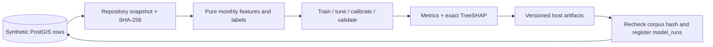

# Architecture

M0 runs a PostGIS 3 / PostgreSQL 16 database, a FastAPI service, and a React/Vite web app.
Compose waits for database and API health checks before starting dependent services.
The web development server proxies `/api` to FastAPI. `/health` is an API liveness alias;
the canonical OpenAPI route is `/api/v1/health`. Database readiness is separate in M0.

The initial MapLibre map uses a local background style and requires no external tiles.
Vite bundles MapLibre's worker explicitly as an ES module, so its URL works in both
development and production builds. This uses MapLibre's
[worker URL configuration](https://maplibre.org/maplibre-gl-js/docs/API/functions/setWorkerUrl/).
M1 generates an invented network, weather, and correlated outages entirely in
`data/generator`. The seed service passes that immutable corpus to a repository;
the repository serializes concurrent seeds with a transaction-level advisory lock,
replaces demo rows atomically, and verifies loaded counts and a database fingerprint.
Database DDL is applied only by Alembic. Integration tests use a separate ephemeral
PostGIS database.

M2 reads immutable training inputs through `app/repositories/training.py` in a
repeatable-read, read-only transaction. Pure ML functions build historical features
and future labels, purge label overlap, select on tuning months, calibrate on
separate months, and evaluate the final holdout. The training CLI runs in a fresh
Compose container with a host artifact mount; the API keeps serving during training.

Artifacts are staged on the same filesystem and renamed to a unique version
directory before database registration. Registry writes share the seed advisory
lock and reject changed source data. Database rows identify registered versions;
there is no mutable file pointer to race with concurrent training. Normal failed
registration cleans up its newly written version. A crash can leave an orphan
directory but cannot advertise a partially staged artifact through `model_runs`.
Asset rescoring and serving model information remain M3 work.
