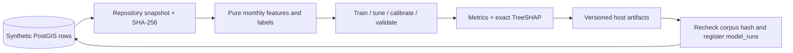

# Architecture

GridWatch runs a PostGIS 3 / PostgreSQL 16 database, a FastAPI service, and a React/Vite web app.
Compose waits for database and API health checks before starting dependent services.
The web development server proxies `/api` to FastAPI. `/health` is an API liveness alias;
the canonical OpenAPI route is `/api/v1/health`. `/api/v1/ready` checks PostGIS and
the required migrated schema. API startup runs Alembic before serving HTTP;
Compose gates the web container on API readiness. An empty migrated database is
ready before explicit seeding/training. Production replicas would need a separate
migration job. Compose exposes loopback web/API ports, with no database host port.

The initial MapLibre map uses a local background style and requires no external tiles.
Vite bundles MapLibre's worker explicitly as an ES module, so its URL works in both
development and production builds. This uses MapLibre's
[worker URL configuration](https://maplibre.org/maplibre-gl-js/docs/API/functions/setWorkerUrl/).
M1 generates an invented network, weather, and correlated outages entirely in
`data/generator`. The seed service passes that immutable corpus to a repository;
the repository serializes concurrent seeds with a transaction-level advisory lock,
replaces demo rows atomically, and verifies loaded counts and a database fingerprint.
Database DDL is applied only by Alembic. Integration tests use a separate ephemeral
PostGIS database.

M2 reads immutable training inputs through `app/repositories/training.py` in a
repeatable-read, read-only transaction. Pure ML functions build historical features
and future labels, purge label overlap, select on tuning months, calibrate on
separate months, and evaluate the final holdout. The training CLI runs in a fresh
Compose container with a host artifact mount; the API keeps serving during training.

Artifacts are staged on the same filesystem and renamed to a unique version
directory before database registration. Registry writes share the seed advisory
lock and reject changed source data. Database rows identify registered versions;
there is no mutable file pointer to race with concurrent training. Normal failed
registration cleans up its newly written version. A crash can leave an orphan
directory but cannot advertise a partially staged artifact through `model_runs`.

M3 read routes use a repeatable-read, read-only session and return typed Pydantic
responses. Repositories own SQL, spatial filtering, aggregation, and GeoJSON
conversion. `make types` exports schemas and operation contracts directly from
OpenAPI for the frontend. Geometry remains EPSG:4326.

```mermaid
flowchart LR
  POST[POST /risk/rescore] --> Lock[Dedicated scoring advisory lock]
  Lock --> Snapshot[Repository snapshot + latest passing model]
  Snapshot --> Verified[Verify artifact checksums and registered provenance]
  Verified --> Score[Pure historical features, probability, TreeSHAP]
  Score --> Tx[Corpus lock + recheck hash/version + atomic replacement]
  Tx --> Risks[(risk_scores)]
  Risks --> Reads[Summary, geography hotspots, asset detail]
  Reads --> API[Typed v1 responses and generated client contracts]
```

Scoring uses the next UTC day after the last weather observation rather than the
wall clock; `prediction_cutoff` and actual `scored_at` are stored separately.
SHAP and XGBoost load when scoring is requested, keeping health/startup and
read routes independent of model deserialization. The latest passing model is
looked up each time. A newer trained model does not automatically overwrite an
earlier score batch; `/model` reports both available and scored versions.

Hotspot edges use `ST_DWithin` on geography at 500 metres. A pure connected-component
function groups those edges deterministically; PostGIS calculates geography
centroids and aggregate scores. Integration tests exercise every endpoint, real
scoring, rollback, competing requests, corpus/model changes during prediction,
and invalid artifacts. The stack smoke command performs actual HTTP rescoring.

The M4 dashboard uses generated OpenAPI contracts and TanStack Query. It loads all
asset and hotspot pages before showing a ranking, checks scoring stamps and totals,
and rejects a batch that changes during loading. Filters and top-ten transformer
ranking operate on that complete cached snapshot. MapLibre renders local GeoJSON
with no remote tiles or tokens; an accessible ranked list also supports selection.
Summary cards and hotspot centres describe the whole fleet, independent of filters.
Asset selection displays the same snapshot's signed TreeSHAP factors immediately;
the detail query loads ten outage events per page and rejects a different scoring
stamp. Query functions consume AbortSignals, so changing selection cancels obsolete
requests. Error and empty states distinguish missing data, unscored assets, and
failed loads. The ranked list provides a keyboard-accessible path without WebGL.

The model page at `#model` reads verified current metadata and independently
paginated registered version history. Hash navigation uses the browser API, without
an additional routing dependency. Available and scored versions remain distinct;
refresh invalidates the model/history queries without restarting the app. Metrics
compare calibrated estimators on the same chronological validation asset-months.
History flags derive from recorded quality-gate and PR-AUC lift values and do not
claim artifact verification for historical runs.

The shared rescore control sends a single non-retried POST. It remains pending
through the save and cache refresh. Reads started before saving are cancelled;
the complete fleet snapshot is replaced atomically in the query cache, model and
history queries are invalidated, and selected detail keys follow the new scoring
stamp. Failed POSTs leave the displayed cache intact. A committed score batch with
a failed subsequent GET is reported as saved with a refresh failure, and the
separate Refresh views action retries reads without sending another scoring POST.

## Operations and delivery

An outer ASGI wrapper attaches validated or generated request IDs to all HTTP
responses, including errors. JSON request logs record fixed route templates,
methods, status codes, and elapsed time, omitting query strings, headers, request
bodies, and exception text. `/api/v1/metrics` exposes lock-protected process-local
request counts, cumulative durations, in-flight count, and uptime. Unknown paths
share one bucket, and counters reset at restart.

GitHub Actions installs lockfile dependencies with npm/uv caching and pinned action
revisions. It runs lint/types, unit and real ephemeral PostGIS integration tests,
frontend tests/build, generated-type drift checks, Docker startup, seed/train,
two-run reproducibility, and HTTP/PostGIS smoke verification. The local
`make verify-clean` command uses a separate clone, Compose project, ports,
credentials, database volumes, and artifact directory, then exercises a database
outage and recovery before removing that project's containers and volumes.

The local web container runs Vite's development server, which proxies `/api` to
FastAPI. Production hosting, authentication, scheduled retraining, and persistent
metrics storage remain outside M0–M7.
