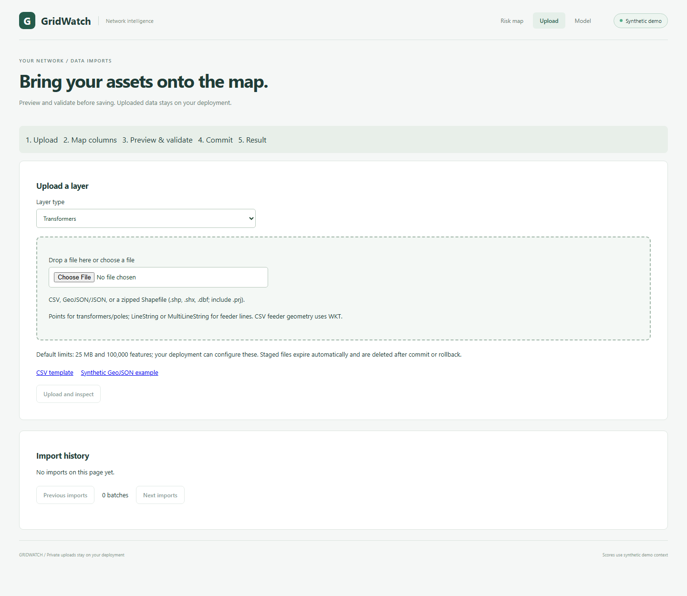
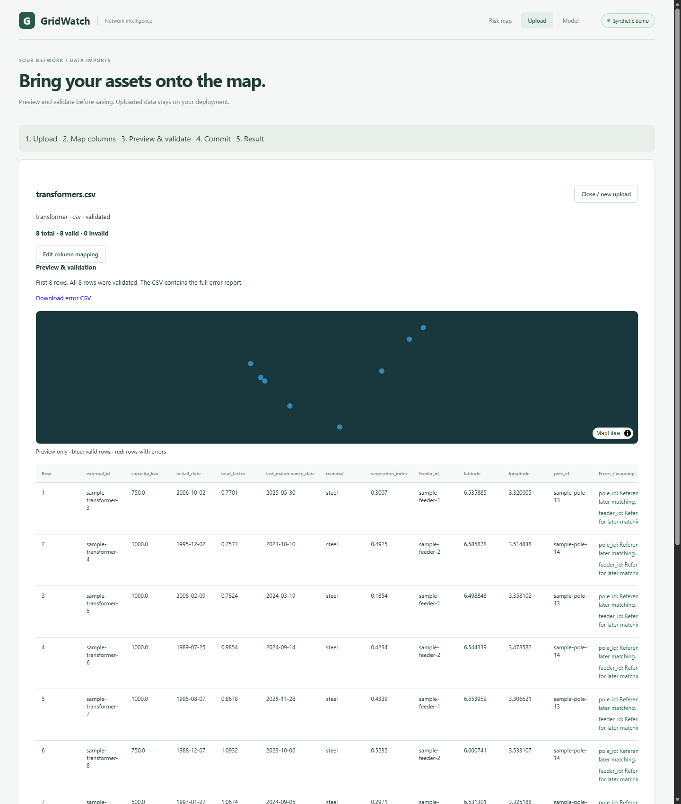

# Uploads

## Upload page

Open **Upload** in the navigation. Choose transformers, poles, or feeder lines,
then drop a single CSV, GeoJSON/JSON, or zipped Shapefile. Download a CSV template
or a synthetic GeoJSON example from the same page. Example geometries and
attributes are generated by `data/generator`, never from uploaded data.

After inspection, review suggested column matches. External ID is required;
tabular points need latitude/longitude or WKT. Embedded spatial geometry needs no
column mapping. Select a source CRS if it is missing/unreadable, and select a date
convention if the dates are ambiguous. Validation checks every row without
changing the asset tables. The preview table and mini map show the first 20 rows;
red cells/rows identify errors, and the downloadable CSV contains all errors.

Choose whether to import valid rows only when invalid rows exist. Rescoring and
training-median consent are separate unchecked options. Commit runs in the worker;
the page polls its progress. A scoring failure keeps the import saved and links
to the Model page for retry. View on map zooms to the saved extent; the URL stores
only a batch ID. Closing before commit leaves assets unchanged and staged files
expire at the displayed time. History reopens batches and offers confirmed
rollback. Rollback removes inserted assets and restores updated assets; dependent
newer batches must be undone first. Derived network scores are cleared on undo.

Polling omits the full error array (`GET /imports/{id}?include_errors=false`),
but preserves preview row errors. The default detail endpoint and error CSV
retain the complete error report. History omits previews and full errors.

## Try the synthetic samples

The [sample directory](../data/samples/README.md) contains eight transformers as
CSV, eight poles as GeoJSON and projected Shapefile, two feeder lines as GeoJSON,
and a broken CSV with one valid/four invalid rows. All originate in the existing
synthetic generator. Seed, train and rescore the demo before importing them.
Upload transformers first, then poles and feeders: unresolved parents warn and
resolve on later imports. Re-uploading the CSV or the matching Shapefile poles
updates stable IDs. After all three layers, expect 18 additional assets, not 26.
Rescore to see the imported estimates; these complete samples do not need median
defaults. Roll back dependent batches in reverse order.





## Prepare a GIS export

Keep a persistent string external ID column in every export, and preserve parent
external IDs in transformer `pole_id`/`feeder_id` fields. Export one geometry layer
per file. Prefer ISO dates and decimal points, preserve leading-zero IDs as text,
and check empty geometries before export. Spreadsheet CSV exports should use
UTF-8 and comma or semicolon delimiters. Coordinates use longitude/X before
latitude/Y in geometry; the column mapper handles tabular names.

In QGIS, use **Export > Save Features As** on a vector layer, select GeoJSON or
ESRI Shapefile, and choose the output CRS. EPSG:4326 is a convenient GeoJSON
choice. See [QGIS vector export documentation](https://documentation.qgis.org/3.44/en/docs/user_manual/managing_data_source/create_layers.html).

In ArcGIS Pro, **Features To JSON** can produce GeoJSON; choose GeoJSON output
and project to WGS84. An Esri JSON feature-set object is not a GeoJSON
FeatureCollection. See [Esri's export documentation](https://doc.esri.com/en/arcgis-pro/latest/tool-reference/conversion/features-to-json.html).
Use **Project** to transform coordinates. **Define Projection** changes the CRS
metadata, so use it only when correcting a known missing/wrong definition, not
to convert coordinates. See [Esri's CRS guidance](https://pro.arcgis.com/en/pro-app/3.3/tool-reference/data-management/define-projection.htm).

For Shapefile, zip the matching `.shp`, `.shx`, `.dbf`, and `.prj` together; include
`.cpg` for encoding. Do not include a geodatabase, nested archives, unrelated
layers, or executable files. DBF field names are shortened, so confirm their
mapping. Keep the true projected CRS and `.prj`, or deliberately export to
EPSG:4326; GridWatch reprojects from the declared/selected CRS. If `.prj` is absent
or unreadable, identify the actual source CRS before validating. Choosing a CRS
does not repair coordinates recorded in another system.

## Data policy

Only synthetic/public material may be committed: examples, test fixtures, docs,
screenshots, and sample files. At runtime, users may upload their own data, which
stays on their deployment. Deployers must supply access control: GridWatch has
no real authentication. Do not expose it to untrusted networks without that control.

Default upload/staging directories are gitignored. Import and parser/database
logs suppress arbitrary messages, exception text, row contents, coordinates, and
filenames; import events contain batch UUIDs, nonnegative counts, and fixed codes.
SQLAlchemy engine exceptions hide bind parameters. Do not print uploaded rows or
raw parser exceptions from workers, request handlers, or command-line helpers.

## Storage and limits

Migration `0003` adds import history, durable job state and leases, expiring staged
rows, and an undo journal. Asset relationships/identity and nullable source
attributes are represented in storage and typed contracts. MultiLineString feeder
geometry is accepted by the schema, asset API, and map bounds calculation.
Existing seed values remain intact, and import bookkeeping does not change the
legacy model-input fingerprint. Asset IDs now have a sequence, advanced after
seeding so future generated IDs do not collide with deterministic seed IDs.

`UploadSettings.from_env()` provides configurable limits:

| Variable | Default |
| --- | ---: |
| `UPLOAD_STAGING_DIR` | `uploads/staging` |
| `UPLOAD_MAX_BYTES` | 26,214,400 (25 MiB) |
| `UPLOAD_MAX_FEATURES` | 100,000 |
| `UPLOAD_MAX_EXPANDED_BYTES` | 262,144,000 (250 MiB) |
| `UPLOAD_MAX_ZIP_FILES` | 32 |
| `UPLOAD_MAX_ZIP_RATIO` | 100 |
| `UPLOAD_TTL_SECONDS` | 86,400 (24 hours) |

The bounded staging helper uses UUID filenames, exclusive creation, and partial
file cleanup. Its deletion operation is idempotent and rejects symlink targets.
History records have explicit `expires_at`; the lifecycle worker deletes raw
files and staged rows after commit, rollback, or TTL expiry. The undo journal is
persistent imported-data history, separate from
temporary staging, and is required to restore overwritten records.

## Formats, mapping and validation

Pure helpers parse and validate uploads without writing live asset tables.
Only the four approved dependencies were added: python-multipart, PyShp, pyproj,
and Shapely 2.x, with locked versions in `backend/uv.lock`. No GDAL-based reader
or frontend package was added.

Format detection checks the extension and actual content. `.csv` accepts UTF-8
with or without BOM, comma or semicolon separators, and quoted fields. Blank
records are skipped; error row numbers are one-based data-record positions,
excluding the header. Header duplicates and malformed encodings are rejected;
field-count mismatches are row errors. IDs remain strings, preserving leading
zeros. Map canonical fields to source column names; suggestions recognise `lat`,
`latitude`, `y`, `lon`, `lng`, `longitude`, `x`, common IDs, and abbreviated DBF
names. Ambiguous suggestions require a choice. An empty mapping value disables
that suggestion. One source column cannot populate multiple canonical fields.

JSON accepts GeoJSON FeatureCollections and tabular arrays with coordinate fields.
Feature IDs can supply `external_id` when properties lack it. GeoJSON geometry
takes precedence, followed by mapped WKT and then mapped coordinate columns.
Standard GeoJSON and coordinate tables default to EPSG:4326. A legacy declared
EPSG/WKT GeoJSON CRS is honoured if valid; other declarations require user selection.
Malformed JSON, duplicate property keys, and nonfinite JSON numbers are rejected.
NUL/invalid Unicode properties make their row invalid; staged preview text is
made JSONB-safe so valid sibling rows remain usable.

Shapefile ZIPs must contain one matching `.shp`/`.shx`/`.dbf` set. `.prj` is parsed
with `pyproj.CRS.from_wkt`. Missing/unparseable `.prj` produces `CRS_REQUIRED`;
validation needs an explicitly chosen CRS. Coordinate appearance is never used
to guess one. DBF decoding tries UTF-8 first, then a valid `.cpg`, then latin-1;
fallback is reported by a fixed warning code. Null shapes are invalid rows.
LineString/MultiLineString parts are preserved; points serve poles/transformers.
Reprojection is offline, uses explicit X/Y order, and stores EPSG:4326. Height
coordinates in GeoJSON/WKT are removed with a warning because the asset schema is
two-dimensional; the Shapefile reader supplies its two-dimensional geometry view.

ZIP inspection rejects traversal/absolute/drive paths, backslashes, symlinks,
encrypted entries, duplicate names, excess file counts, excessive expanded bytes,
and excessive compression ratios. Only expected components are read, directly
from the archive into bounded buffers; nothing is extracted to disk. Binary
Shapefile record counts and sizes are checked against actual bytes before the
native reader can allocate based on declared counts.

Validation checks required external IDs, finite coordinates and ranges, `(0,0)`,
geometry type/validity, numeric ranges, dates/order, and duplicate IDs. Every copy
of an ID repeated in a file is invalid; partial success never picks an arbitrary
winner. Unknown pole/feeder IDs produce warnings and retain the external reference
for later resolution. Missing optional attributes stay missing; no source values
or model defaults are invented here. CSV/JSON numeric fields use decimal points.

Transformers require positive capacity when supplied; pole capacity may be zero.
Load factor, when supplied, must be greater than zero and at most 1.5. Vegetation
is 0–1. Capacity is below 1,000,000 kVA, matching the existing database constraint.
Dates accept ISO dates/timestamps, year-first slash dates, numeric day/month dates,
and abbreviated month names. Ambiguous numeric dates require an explicit
day-first/month-first convention. Errors and native-library warnings never expose
source values or native exception text in logs.

## API and durable import lifecycle

`make up` now starts an `import-worker` alongside PostGIS, API, and web. The API
and worker share the private `upload_staging` Docker volume. Upload limits and TTL
come from `.env.example`; Compose passes them to both processes. No extra service
or package is required. The Upload page uses these same endpoints.

All paths below have prefix `/api/v1`. Upload, validation, commit, and rollback
return **202** with a batch detail. Poll `GET /imports/{id}` until its latest
`job.status` becomes `completed` or `failed`. The initial upload response can have
null format/CRS and no columns while inspection is queued. After inspection it
contains detected columns, mapping suggestions, feature count, CRS, global warning
codes, and the first 20 rows. Validation supplies EPSG:4326 geometries and row
errors/warnings for that preview, plus all row errors in `errors`.

| Endpoint | Request / result |
| --- | --- |
| `POST /imports` | Multipart `file` and `layer_type=transformer`, `pole`, or `feeder_line` |
| `POST /imports/{id}/validate` | Optional JSON `column_mapping`, `source_crs`, `date_format` |
| `POST /imports/{id}/commit` | JSON `valid_rows_only` (default false), `rescore` (default false), `accept_scoring_defaults` (default false) |
| `POST /imports/{id}/rollback` | No body; undo the batch or return a conflict |
| `GET /imports` | History with `limit` 1–100 (default 20) and `offset` |
| `GET /imports/{id}` | Counts, status, preview, errors, extent, latest job and progress |
| `GET /imports/{id}/errors.csv` | Download `row_number,field,reason`; includes safe file-level failure codes |
| `GET /imports/templates/{layer_type}.csv` | CSV column header template; feeder lines use WKT geometry |
| `GET /imports/templates/{layer_type}.geojson` | Downloadable generator-backed synthetic feature |

For example, in PowerShell use `curl.exe -F "file=@your-transformers.csv" -F
"layer_type=transformer" http://localhost:8000/api/v1/imports`. Then use the returned
UUID in the validation and commit paths. On Linux/macOS use `curl`. A mapping body
such as `{"column_mapping":{"external_id":"Asset ID","latitude":"Y","longitude":"X"},
"source_crs":"EPSG:4326","date_format":"day_first"}` overrides suggestions. The
source CRS also applies to mapped X/Y coordinates and WKT. Missing/unparseable
Shapefile `.prj` requires this explicit selection; GridWatch does not guess.

An illustrative synthetic GeoJSON structure is:

```json
{"type":"FeatureCollection","features":[{"type":"Feature","properties":{"external_id":"demo-pole"},"geometry":{"type":"Point","coordinates":[3.3,6.5]}}]}
```

Validation writes only private staging. If any rows are invalid, commit returns
409 until the caller explicitly chooses `{"valid_rows_only":true}`. Invalid rows
are skipped and remain in the downloadable report. A file with no valid rows
cannot be committed. Parse/validation failures retain staging until its TTL so
the user can correct a mapping/CRS. Failed revalidation prevents committing an
older validated result. Commit failures preserve all existing assets and staged
rows for diagnosis/revalidation; no partial database transaction is published.

Upserts use `(asset type, external_id)` and preserve the original creator's
`batch_id`; `last_batch_id` and revision record the most recent change. An absent
or blank optional field preserves the existing value on re-import. It does not
clear that value. Validation also checks date ordering against retained dates.
External pole/feeder identifiers are resolved when parents exist, or retained
unresolved with a warning. A later parent import resolves waiting children and
journals those relationship changes for undo. Commits use 1,000-row upserts and
one transaction, including the undo journal and score invalidation.

Rollback removes inserted assets and restores before-images of updated assets,
including relationship changes. It rejects known later changes/dependencies with
409; undo dependent batches in reverse order. The worker checks again before
writing, so a conflict arising after enqueue becomes a failed rollback job with
`ROLLBACK_CONFLICT`. Old journal revisions are advanced when a later rollback
restores them. Derived risk scores are invalidated by both commit and rollback.

Optional rescoring is a separate durable job after import commits. Its failure
leaves the batch imported; inspect the latest job status. The inference contract
below preserves the strict training checks.

Jobs use PostgreSQL leases and token checks before committing effects. A heartbeat
renews leases and persists row progress. Worker restart recovers expired leases;
an older worker that loses its token rolls its asset transaction back. The separate
worker has a Compose healthcheck. Files and temporary database rows are removed
after commit/rollback and by the worker's 30-second cleanup cycle after TTL expiry.
Cleanup retries terminal-file deletion and removes UUID-named expired orphan files.
History, safe error reports, and persistent undo before-images remain on the local
deployment; they are not temporary staging. `make seed` refuses a database with
import history so it cannot erase uploaded data.

The HTTP body is bounded before multipart parsing, including requests without
Content-Length; multipart headers/fields have a 64 KiB allowance above the file
limit. Actual file bytes are independently checked against `UPLOAD_MAX_BYTES`.
Stored paths are UUID-derived; the original basename is sanitized for history.
Reports include canonical fields and fixed reasons rather than uploaded values.

## Scoring uploaded assets

Start with the seeded and trained demo described in the README before uploading.
Asset uploads alone do not provide a trained model, weather history or failure
labels. `make seed` continues to refuse a deployment containing private import
history; it cannot erase uploaded data to create that missing reference corpus.

To commit and request scoring with the approved default policy:

```json
{"valid_rows_only":true,"rescore":true,"accept_scoring_defaults":true}
```

The import transaction finishes before the scoring job starts. Poll the latest
job in batch detail for its outcome; a missing consent produces
`SCORING_DEFAULTS_REQUIRED`, while the committed batch remains imported. Retry
scoring through `POST /api/v1/risk/rescore` with
`{"accept_scoring_defaults":true}` or the Model page checkbox and Rescore button.
The checkbox starts unchecked. A bodyless rescore still works for the original
demo or uploaded assets that supply every required model attribute.

When needed, the in-memory `per-type-median-v1` policy substitutes installation
date, capacity, load factor and vegetation using only the hash-verified synthetic
training corpus. Defaults never replace stored source values. Material and last
maintenance are not features and do not require defaults. Missing feeder links
use the asset location for weather assignment; unresolved source references remain
available for later parent imports as before.

Default training and its hash exclude imported assets and associated outages.
Inference retains that training hash check and also hashes the entire source
snapshot, including batch IDs/revisions. Both are rechecked before score writes.
Migration `0004` stores each score's inference metadata. Asset API risk values
include `provenance`, `imputed_fields`, the applied `imputed_values`, and warnings; summary scoring stamps carry
the same global provenance. Legacy scores have unknown/null provenance until
rescored. The asset panel identifies applied medians and synthetic history.

| Diagnostic | Meaning |
| --- | --- |
| `SYNTHETIC_HISTORY` | Weather/outage context comes from the invented demo network |
| `NO_ASSET_OUTAGE_HISTORY` | No historical outage is available for this asset in that context; zero count is not evidence of reliability |
| `IMPUTED_ATTRIBUTES` | Model inputs include explicitly accepted training medians |
| `OUTSIDE_TRAINING_EXTENT` | Representative location lies outside the reference asset bounding box |
| `UNAVAILABLE_FEEDER_ANCHOR` | The feeder is unavailable at the cutoff; features use the asset location |

The demo cutoff remains 2026-01-01 for its 2025-12-31 weather end date. Supplied
installation dates on or after that cutoff remain unscored. `unscored_by_reason`
in the rescore response counts `NOT_INSTALLED_AT_CUTOFF`; those assets remain
visible with null risk. Dates and coordinates are not adjusted to manufacture
a prediction. These are illustrative model outputs with no validation for real
utility assets, including those inside the training extent.

LineString feeder locations use their midpoint, and MultiLineStrings use
`ST_PointOnSurface`, consistently for inference and hotspots. The main map keeps
their full geometries. Summary groups with `feeder_id=null` contain unassigned
point assets, so they do not inflate the displayed feeder count. Import or
rollback still invalidates every derived risk score; rescore to replace the batch.
